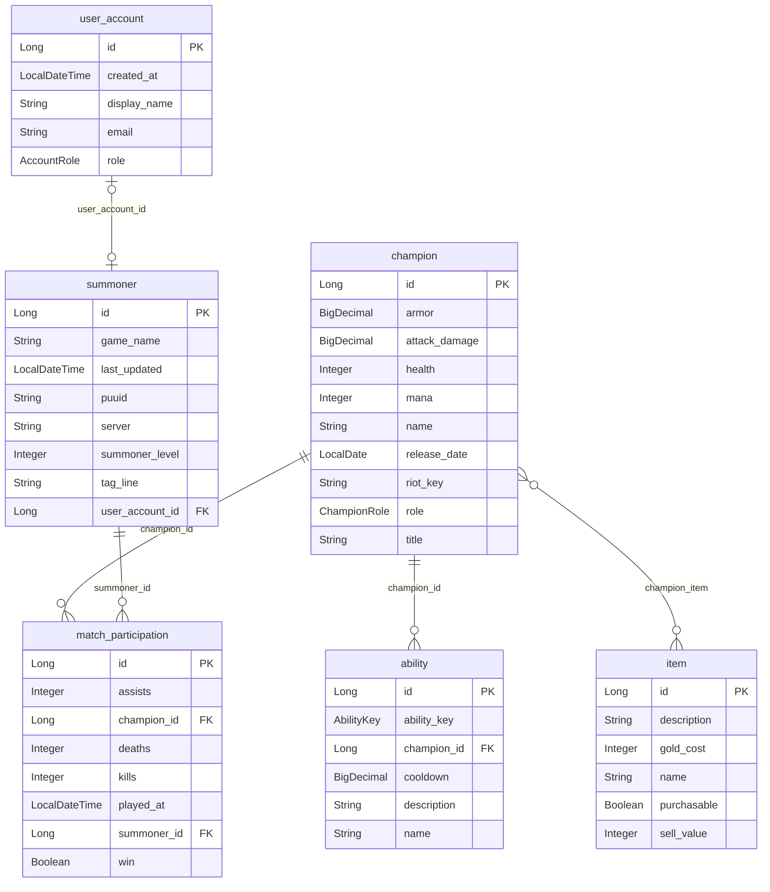

# Schemat bazy danych

Plik generują reguły projektu (panel Maven → Lifecycle → verify). Nie edytujcie go ręcznie.

Tabele: 7 (w tym tabele łączące @ManyToMany: champion_item) · kolumny: 43 · relacje: 3 × @ManyToOne, 1 × @OneToMany, 1 × @OneToOne, 1 × @ManyToMany

| Tabela | Encja | Kolumny | Klucze obce |
|---|---|---|---|
| ability | Ability | 6 | champion_id |
| champion | Champion | 10 | — |
| item | Item | 6 | — |
| match_participation | MatchParticipation | 8 | champion_id, summoner_id |
| summoner | Summoner | 8 | user_account_id |
| user_account | UserAccount | 5 | — |

